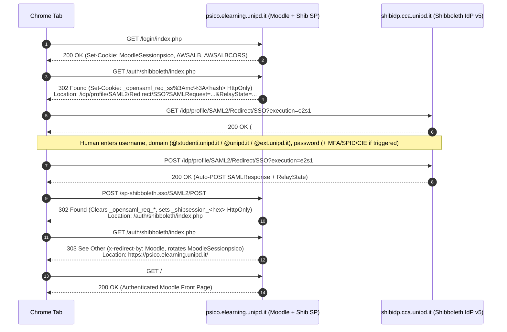

# Stage 1 Investigation — Authentication, UniPD SSO & Session Management
* **Document ID**: MOODLE-DOC-002
* **Canonical Path**: docs/investigation/01-auth-and-session-flow.md
* **Version**: 0.1.0
* **Status**: Verified
* **Owner**: Architect
* **Last Updated**: 2026-11-19

## 1. Executive Summary
* **`[VERIFIED]`** `https://psico.elearning.unipd.it` runs **Moodle 4.5** (`tool_consumer_info_version: 2024100713.01`, theme `dlm_theme`) behind **Amazon CloudFront** and an **AWS Application Load Balancer** (`Apache/2.4.69 (Amazon Linux)`).
* **`[VERIFIED]`** Institutional authentication uses **SAML 2.0 via Shibboleth** (`auth/shibboleth/index.php` -> `shibidp.cca.unipd.it`, Shibboleth IdP v5 on `Jetty(12.1.13)`), returning via a **custom SP assertion endpoint** `/sp-shibboleth.sso/SAML2/POST` (note: *not* the default `/Shibboleth.sso/SAML2/POST` used on PoliMi WeBeep).
* **`[VERIFIED]`** Session state splits across JS-accessible `MoodleSessionpsico` (`SameSite=Lax`, non-`HttpOnly`) and `HttpOnly` `_shibsession_*`. Because Chrome MV3 content scripts cannot read `HttpOnly` cookies, extension fetches and downloads must run via browser-authenticated contexts (`chrome.downloads.download()`, background `fetch(..., { credentials: 'include' })` with `host_permissions`, or `chrome.cookies`).

## 2. Unauthenticated Login Page (`https://psico.elearning.unipd.it/login/index.php`)
* **`[VERIFIED]` Platform & Config Hints (`window.M.cfg`)**:
  * `wwwroot`: `https://psico.elearning.unipd.it`
  * `apibase`: `https://psico.elearning.unipd.it/r.php/api`
  * `theme`: `dlm_theme`
  * `sessiontimeout`: `"7200"` (2 hours), `sessiontimeoutwarning`: `"1200"` (20 minutes)
  * `slasharguments`: `1`, `userId`: `0` when unauthenticated
  * YUI module list confirms `moodle-availability_esse3enrols-form` (UniPD ESSE3 enrollment availability plugin).
* **`[VERIFIED]` Auth Methods Exposed**:
  1. **Primary Institutional SSO Tab (`Single Sign-On`)**:
     * Link selector: `a.login-identityprovider-btn` (`a[href*="auth/shibboleth/index.php"]`)
     * Label: `SingleSignOn - UniPD`
     * Target: `https://psico.elearning.unipd.it/auth/shibboleth/index.php`
  2. **Secondary Manual Tab (`Login Standard`)**:
     * Form `#login.login-form` (`POST https://psico.elearning.unipd.it/login/index.php`) with `username`, `password`, and hidden CSRF `logintoken`.
  3. **Guest Access**:
     * Form `#guestlogin` (`button#loginguestbtn`, `"Access as a guest"`).
* **`[VERIFIED]` Response Security Headers**:
  * `x-frame-options: sameorigin` on `psico.elearning.unipd.it`.

## 3. Shibboleth SAML 2.0 Redirect & Callback Chain

### Observed IdP Form & Transit Details (`[VERIFIED]`)
* **IdP Host**: `shibidp.cca.unipd.it` (`Jetty(12.1.13)`, title `Servizio di Accesso Web - idp8-shib5`).
* **Anti-Framing Headers on IdP**: `content-security-policy: frame-ancestors 'none'; base-uri 'none';` and `x-frame-options: SAMEORIGIN, DENY`. Login **cannot** happen inside a hidden iframe; an interactive browser tab is mandatory.
* **IdP Form (`form#user-login-form`)**:
  * Action: `POST /idp/profile/SAML2/Redirect/SSO?execution=e2s1`
  * Fields: `j_username`, `j_username_js`, `j_password`, `dominio` radio (`@unipd.it`, `@studenti.unipd.it`, `@ext.unipd.it`), submit `_eventId_proceed` (`#login_button_js`, `#Login`).
  * Federated alternatives on IdP page: **Entra con SPID** and **CIE**.
* **MFA Behavior**: `[OBSERVED]` Direct `@studenti.unipd.it` password submission completed without an MFA challenge in the observed session; `[INFERRED]` SPID/CIE or staff/conditional accounts may trigger MFA/2FA, reinforcing `DEC-002` that the user authenticates interactively in their own Chrome tab rather than storing secrets.

## 4. Authenticated vs. Unauthenticated DOM & JS Markers (`[VERIFIED]`)

| State | URL / Redirect Signal | `document.body.className` | Positive / Negative DOM & JS Signals |
| :--- | :--- | :--- | :--- |
| **Unauthenticated** | `/login/index.php` or `302` -> `shibidp.cca.unipd.it` | Contains `notloggedin`, `pagelayout-login` | `form#login`, `a.login-identityprovider-btn`, `M.cfg.userId === 0`, no `.usermenu` dropdown items |
| **Authenticated** | `/` (`Home`), `/my/`, `/my/courses.php`, `/course/view.php`, `/mod/...` | Lacks `notloggedin` | `.usermenu` present, `.logininfo` present, `Number(M.cfg.userId) > 0`, `M.cfg.sesskey` (10-char CSRF token) populated, `nav a[href*="/my/courses.php"]` present |

## 5. Redacted Cookie Inventory (`[VERIFIED]`)

| Cookie Name | Host Scope | Path | `HttpOnly` | `Secure` | `SameSite` | Expiry / Lifecycle | Role |
| :--- | :--- | :--- | :--- | :--- | :--- | :--- | :--- |
| `MoodleSessionpsico` | `psico.elearning.unipd.it` | `/` | **No** | Yes | `Lax` | Session | Primary Moodle PHP session cookie (rotated on login) |
| `_shibsession_707369636f...6f6f646c65` | `psico.elearning.unipd.it` | `/` | **Yes** | Yes | *(omitted)* | Session | Shibboleth SP session (`hex("psicohttps://psico.elearning.unipd.it/moodle")`) |
| `_opensaml_req_ss%3Amc%3A<hash>` | `psico.elearning.unipd.it` | `/` | **Yes** | Yes | `None` | Transient (cleared at SAML2 POST) | OpenSAML in-flight auth state correlation |
| `AWSALB` | `psico.elearning.unipd.it` | `/` | No | No | *(omitted)* | Persistent (+7 days) | AWS ALB target stickiness |
| `AWSALBCORS` | `psico.elearning.unipd.it` | `/` | No | Yes | `None` | Persistent (+7 days) | AWS ALB CORS stickiness |
| `__Host-JSESSIONID` | `shibidp.cca.unipd.it` | `/` | **Yes** | Yes | *(omitted)* | Session | IdP Jetty session (never touches Moodle) |
| `ROUTEID` | `shibidp.cca.unipd.it` | `/` | `[UNKNOWN]` | `[UNKNOWN]` | `[UNKNOWN]` | Session | IdP backend node stickiness |

## 6. MV3 Extension Implications
1. **Never rely on `document.cookie` export alone**: `_shibsession_*` is `HttpOnly`, and unauthenticated `pluginfile.php` requests redirect to login (`[VERIFIED]` via `fetch(..., { credentials: 'omit' })` failing with network/redirect error).
2. **Cookie-Free CDN Exception (`Kaltura`)**: Once a Kaltura entry ID and short-lived `ks` are obtained from Moodle's `player_bridge.php`, Kaltura API/CDN requests do **not** require `psico.elearning.unipd.it` cookies (`[VERIFIED]` — see [03-video-playback-and-download-mechanics.md](file:///c:/Users/user/Project/moodle/docs/investigation/03-video-playback-and-download-mechanics.md)).
3. **CSRF `sesskey` Requirement**: Moodle AJAX calls (`POST /lib/ajax/service.php?sesskey=[REDACTED]&info=...`) require both the active session cookies and `M.cfg.sesskey` extracted from any authenticated Moodle page (`[VERIFIED]`).
