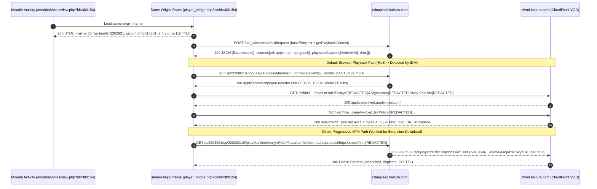

# Stages 4 & 5 Investigation — Video Playback, IDM Detection & Download Feasibility
* **Document ID**: MOODLE-DOC-004
* **Canonical Path**: docs/investigation/03-video-playback-and-download-mechanics.md
* **Version**: 0.1.0
* **Status**: Verified
* **Owner**: Architect
* **Last Updated**: 2026-11-19

## 1. Executive Summary
* **`[VERIFIED]`** `mod_kalvidres` does **not** use a cross-origin LTI redirect for single lectures; it renders a **same-origin iframe** (`/mod/kalvidres/player_bridge.php?cmid=<cmid>`) containing `partnerId=2203921`, `uiconfId=43513601`, `entryId`, and a 1-hour `ks` token.
* **`[VERIFIED]`** Browser playback uses **Kaltura PlayKit JS** streaming **unencrypted VOD HLS** (`a.m3u8` -> `index.m3u8` -> muxed H.264/AAC `.ts` segments with `drm: []` and zero `#EXT-X-KEY`). **This is why IDM detects lectures**: IDM hooks `.m3u8` (`application/x-mpegurl` / `application/vnd.apple.mpegurl`) responses and muxes the HLS segments externally.
* **`[VERIFIED]` CRITICAL ARCHITECTURAL FINDING**: For **every tested `mod_kalvidres` entry (5 of 5 across 5 courses)**, Kaltura's `playManifest` endpoint (`format/url` and `format/download`) **also redirects directly (`302`) to a single progressive `.mp4` file** on `cfvod.kaltura.com/scf/pd/...` (`Content-Type: video/mp4`, HTTP `206 Partial Content`, valid `ftypisom` MP4 header, `24h` CloudFront signed URL TTL, zero cookies/Referer required).
* **`[VERIFIED]`** Therefore, **direct `chrome.downloads.download()` works natively without segment remuxing** for both Kaltura lectures (`format/url` MP4) and Moodle-hosted `mod_videotime` / `mod_resource` MP4s (`/pluginfile.php/...`), with an optional MV3 Offscreen HLS fallback if `format/url` is ever disabled on a specific entry.

## 2. Stage 4 — Playback Architecture & Network Waterfall

### 2.1 `mod_kalvidres` Playback Pipeline (`[VERIFIED]`)

### 2.2 Frame Topology & Player Details (`[VERIFIED]`)
* **Top-level DOM**: `https://psico.elearning.unipd.it/mod/kalvidres/view.php?id=<cmid>`
* **Embedded Player Iframe**: `<iframe id="contentframe" class="kaltura-player-iframe" src="https://psico.elearning.unipd.it/mod/kalvidres/player_bridge.php?cmid=<cmid>">`
  * **Origin**: **Same-origin** (`https://psico.elearning.unipd.it`)! `all_frames: true` is optional if the extension parses `player_bridge.php` via `fetch()`, or trivial if reading same-origin `iframe.contentDocument`.
* **Player Library**: Kaltura PlayKit JS v7.289 (`https://cdnapi.kaltura.com/p/2203921/embedPlaykitJs/uiconf_id/43513601`), attaching an MSE `blob:https://psico.elearning.unipd.it/...` stream to `<video>`.
* **Transcripts / Captions**:
  * Moodle page renders an accessible transcript block below `#contentframe` (`h5` "Transcript" with timestamps) when captions exist.
  * Kaltura `getPlaybackContext` also returns `playbackCaptions[].webVttUrl` (`.vtt` subtitles, e.g., `https://cdnsecakmi.kaltura.com/api_v3/index.php/service/caption_captionasset/action/serveWebVTT/captionAssetId/.../captions.vtt`).
* **Secondary Media Gallery (`local_kalturamediagallery`)**:
  * Uses `<iframe id="contentframe" src="lti_launch.php?courseid=<id>">` which auto-POSTs an OAuth 1.0 signed `basic-lti-launch-request` to **cross-origin** `https://media19.elearning.unipd.it/hosted/index/course-gallery`, navigating to `https://media19.elearning.unipd.it/channel/<courseid>/<partnerChannelId>`.
* **Secondary `mod_videotime` & `mod_resource` Video Paths**:
  * `mod_videotime` (`id=255123`): Uses Moodle `media_videojs/video-lazy.js` loading direct progressive MP4 `https://psico.elearning.unipd.it/pluginfile.php/<ctx>/videotimeplugin_videojs/mediafile/0/<name>.mp4` (`206 Partial Content`, requires Moodle cookies).
  * `mod_videotime` (`id=274139`): Embeds `https://www.youtube.com/embed/<ytId>` (external YouTube).
  * `mod_resource` (`id=275926`): Embeds `<video><source src="/pluginfile.php/<ctx>/mod_resource/content/0/<name>.mp4">`.

### 2.3 Exact IDM Detection Explanation (`[VERIFIED]`)
1. **Why `<video src="blob:...">` doesn't block IDM**: Kaltura PlayKit feeds MSE via XHR/Fetch requests to `cdnapisec.kaltura.com/.../a.m3u8` (`content-type: application/x-mpegurl`) and `cfvod.kaltura.com/.../index.m3u8` (`content-type: application/vnd.apple.mpegurl`).
2. **IDM Interception Mechanism**: IDM's browser extension monitors `chrome.webRequest` responses for `application/x-mpegurl` / `application/vnd.apple.mpegurl` / `.m3u8` and `video/mp4` (`Content-Type` / URL patterns), parses the HLS master playlist (`BANDWIDTH`, `RESOLUTION`), and hands the signed `.m3u8` URL to IDM's native desktop downloader to pull and remux `.ts` segments.
3. **Why an MV3 Extension Can Do Even Better**: Rather than passively waiting for `<video>` playback to start and muxing HLS segments, an extension can **proactively query `player_bridge.php?cmid=<cmid>` + Kaltura `multirequest`** for an entire course (even in batch!) and resolve the **official progressive `.mp4` `format/url` (`cfvod.kaltura.com/scf/pd/...`)**, passing a clean single-file MP4 directly to `chrome.downloads.download()`.

## 3. Stage 5 — Download Replayability, Sizes, Bitrates & TTL Proofs

### 3.1 Minimal HTTP Replay Probes (`[VERIFIED]`)
All probes used tiny `Range: bytes=0-1023` or `bytes=0-63` requests (no bulk video hoarding):

| Probe Target | Conditions Tested | HTTP Status | Final Host & Path Pattern | `Content-Type` / `Content-Range` | Result / Proof |
| :--- | :--- | :--- | :--- | :--- | :--- |
| Kaltura `format/url` (`1_sirqa9b5`, `1_c1qlwlrw` 1080p) | With `ks` + `Referer`, with `ks` + `no-referrer`, and **without `ks`** | `206` (via `302`) | `cfvod.kaltura.com/scf/pd/p/2203921/.../name/a.mp4?Policy=...&Signature=...&Key-Pair-Id=...` | `video/mp4`, `bytes 0-1023/167215572` | **Pass** (`ftypisom` magic bytes `00 00 00 20 66 74 79 70 69 73 6f 6d`, `fetch()` readable CORS) |
| Kaltura `format/download` (`1_sirqa9b5`, `1_c1qlwlrw`) | With `ks` | `206` (via `302`) | `cfvod.kaltura.com/.../fileName/<Title>_(HD_1080_-_WEB_(H264_4000)).mp4/name/a.mp4` | `video/mp4`, `bytes 0-1023/167215572` | **Pass** (sets canonical filename in CDN path) |
| Kaltura `format/url` across 4 other courses (`257688`, `259390`, `299253`, `278607`) | Both with `ks` and without `ks` | `206` | `cfvod.kaltura.com/scf/pd/...` | `video/mp4` | **Pass (5 / 5 courses)** — passing `ks` still recommended for private entries |
| Kaltura HLS `.m3u8` + first `.ts` segment | `no-referrer` + `Range: bytes=0-1023` | `200` / `206` | `cfvod.kaltura.com/scf/hls/.../seg-1-v1-a1.ts` | `video/MP2T`, `bytes 0-1023/514744` | **Pass** (MPEG-TS sync byte `0x47`, 240 segments, no `#EXT-X-KEY`, `ACAO: *`) |
| Moodle `videotime` `.mp4` (`pluginfile.php`, `id=255123`) | `credentials: 'omit'` | **Failed** (`TypeError: Failed to fetch`) | Redirected away from resource | N/A | **Expected Fail** — Moodle `pluginfile.php` strictly requires active `MoodleSessionpsico` / `_shibsession_*` cookies |

### 3.2 Measured Lecture Sizes, Bitrates & Token TTLs (`[VERIFIED]`)

| Course / `cmid` | `entryId` | `adminTags` | Duration | Available MP4 Flavors (`flavorAssets`) | File Size |
| :--- | :--- | :--- | :--- | :--- | :--- |
| `7075` / `300154` | `1_sirqa9b5` | `kalturacapture,windows,5.2.3` | 39m 23s (`2363`s) | `1_yz2ebdzm` (`640x360`, 160 kbps) & `1_c1qlwlrw` (`1920x1080`, 566 kbps, `isOriginal`) | `47.4 MB` / **`167.2 MB`** |
| `6248` / `257688` | `1_ezq0c0wq` | `zoomentry` | 3m 42s (`222`s) | `1_7t661t45` (`1920x1080`, 771 kbps) | `21.4 MB` |
| `6403` / `259390` | `1_ax75cpuz` | `zoomentry` | 96m 57s (`5817`s) | `1_cw42wpcp` (`1920x1080`, 843 kbps) | **`613.3 MB`** |
| `7003` / `299253` | `1_xrk03wcx` | `zoomentry` | 156m 43s (`9403`s) | `1_9lq3sh9d` (`1920x1080`, 313 kbps) | `368.6 MB` |
| `6559` / `278607` | `1_361lmu8v` | `zoomentry` | 99m 09s (`5949`s) | `1_4dj9ipzx` (`1832x982`, 767 kbps) | **`570.4 MB`** |

* **Token & URL Lifetimes (`[VERIFIED]`)**:
  * **Moodle `MoodleSessionpsico`**: `sessiontimeout = 7200` seconds (2 hours idle timeout).
  * **Kaltura Session (`ks` in `player_bridge.php`)**: `3599` seconds (~**1 hour** TTL from page render).
  * **CloudFront Signed MP4/HLS `Policy` (`AWS:EpochTime`)**: **`86400` seconds (24 hours)** from manifest generation!
* **Important Practical Note on Dual-Stream Kaltura Capture (`[INFERRED]` / `[UNKNOWN]`)**:
  * `1_sirqa9b5` (`kalturacapture`) exposed single-stream `flavorAssets` (no secondary child stream in `baseEntry.list`). Whether any other `kalturacapture` entries on `psico.elearning.unipd.it` use parent/child dual-stream entries (`children` / `dataUrl`) remains `[UNKNOWN]` until encountered; if encountered, an extension can inspect `baseEntry.list` for child entries.
